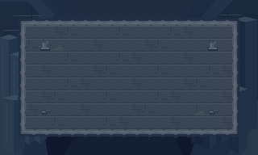

# Fosa abismal · Arte de la arena final

Primera entrega visual del jefe final. Base revisada c022bb7, mercado de TV aprobado. La arena actual es el mapa interno 6 y se alcanza desde el mercado 10. God Fish ocupa un lienzo de cinco casillas por lado en sus poses base. El combate aprobado tiene seis fases. Esta entrega fija la ambientación y los recursos de terreno para diseñar la arena con espacio suficiente.

## Dirección visual

Una plataforma de basalto sobre una fosa submarina. Las paredes del abismo son de azul profundo, con columnas naturales que se pierden a distinta profundidad. Las ruinas pequeñas en el perímetro hacen visible la continuidad con el templo. El suelo de combate usa un gris azulado un poco más claro. El área central queda despejada para los avisos del tridente, burbujas, ataques de puño y objetivos de cada fase.

La referencia conceptual se produjo con ImageGen a partir de una fosa submarina con acantilados de basalto en planos, fragmentos del templo en los márgenes y nieve marina escasa. Los recursos del inventario se dibujaron aparte en cuadrícula nativa.

## Inventario y uso

El [manifest](manifest.json) enumera los 19 PNG. Los tiles y las decoraciones son de 16 × 16. Las tres capas de fondo son de 320 × 192. Usa escala ×3 con vecino más cercano.

| Recurso | Uso en integración |
| --- | --- |
| basalt-floor-0/1/2 | Suelo transitable. Usa el 0 como base y alterna los demás con moderación. |
| basalt-wall | Muro sólido donde haga falta una separación física visible. |
| rim-north/south/west/east | Bordes sólidos. El nombre identifica el lado del precipicio. La transparencia deja ver el abismo. |
| corner-nw/ne/sw/se | Esquinas sólidas con el cuadrante exterior transparente. |
| void | Tile transparente y sólido que ocupa la fosa, con el fondo visible. La transparencia no determina colisión. |
| basalt-rubble, broken-column, silt | Decoraciones sin colisión propia. Ponlas en el perímetro. Para cobertura real, usa geometría sólida y legible. |
| far-trench, basalt-sides, sediment | Fondo opaco profundo, paredes con recorte transparente y partículas sobre transparencia, en ese orden. |

La composición [fondo](preview/fondo.png) muestra las tres capas completas. [Tiles](preview/tiles.png) permite revisar bordes y esquinas. [Arena](preview/arena.png) es una muestra de suelo y precipicio, no el trazado jugable. La superficie y el encuadre finales se validan con el tamaño del jefe y las seis fases.

## Indicaciones para la futura integración

- Respetar mapa 6, llegada desde el mercado, salida, llave y datos guardados. El nuevo trazado debe conservar esos contratos y el punto de regreso previo al combate según la implementación aprobada del mercado.
- Reservar un centro de combate amplio y dos corredores laterales. Comprobar que un cuerpo del tamaño actual pueda desplazarse y que el jugador pueda apartarse a ambos lados de cada trayectoria comprometida. Mantener el objetivo de cada fase y la señal del siguiente ataque dentro de la vista.
- Usar las capas con un desplazamiento discreto si la cámara se mueve. Sujetar el desplazamiento o cubrir los márgenes para evitar bordes vacíos. La capa de sedimento puede moverse lentamente sin tapar suelo ni avisos. No cargar PNG ni actualizar estado desde el dibujo.
- Los bordes y el vacío no son caminos. Verificar colisión y transparencia sobre las cuatro orientaciones de borde y esquina, incluidos proyectiles y movimientos grandes.
- Mantener claros los avisos y objetivos sobre el basalto. Distinguir por silueta y animación los elementos de combate. El fondo carece de destellos intensos y las decoraciones se concentran en zonas que no cruzan las líneas de ataque.
- Revisar captura del jefe a escala con los elementos activos y comprobar legibilidad con la iluminación de la arena, especialmente junto a los límites del encuadre. Validar jugabilidad al integrar el trazado y el combate.

Estado de esta etapa: arte nativo validado y vistas de composición revisadas. El trazado jugable, sprites de God Fish y recursos de sus ataques se preparan en etapas posteriores.
