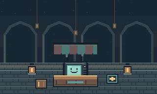
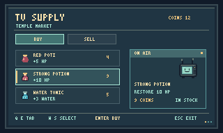
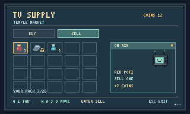
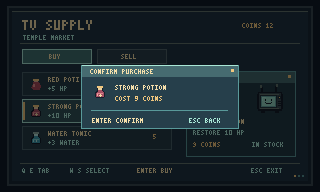

# TV Supply · Mercado del templo

Encargo de arte e integración. Base revisada: 3067a6d, con Handy e Ic aprobados. Lee AGENTS.md, OCTAVA-ZONA.md, ARQUITECTURA.md, NPC_TV, GameFlowController y las pruebas de guardado. Esta entrega define recursos y decisiones propuestas. Construir el mapa y verificar el funcionamiento corresponden a la implementación.

## Tramo de preparación antes del jefe

Traslada la única TV de (26,40) del mapa 6 a su mercado. Mantén el aspecto de la arena, el combate, la llave y el desenlace. El mercado es seguro, sin enemigos, compras obligatorias ni un nuevo rompecabezas.

Conserva la comprobación de las tres placas de TempleExtension antes de cambiar el destino de su salida (mapa 9, 24,5). Conecta 9 → mercado → jefe 6. El mercado utiliza el nuevo mapa interno 10 y 50 × 50 casillas, con recinto compacto. Como anclajes propuestos: piso (17,19) a (30,29), llegada desde octava (24,27), regreso a octava (24,29), salida hacia jefe (24,19) y recepción tras volver del jefe (24,21). No superpongas llegadas y activadores. El regreso a octava se coloca en el lado ya resuelto del portón y fuera del disparador de ida.

Conserva la llegada al jefe en (24,44). Ofrece un regreso a la tienda antes de iniciar su cinemática, desde una casilla contigua segura como (23,44), comprobada contra la geometría. Identifica el regreso con una señal clara. En un combate o cinemática activos no se permite esa transición. Quien carga ya dentro del jefe conserva ubicación y progreso, sin ser devuelto automáticamente.

La zona combina piedra fría y arcos del templo con un toldo a rayas, estantes, lámparas ámbar, cajas y alfombra. Deja el corredor central libre de decoración sólida. Ubicación sugerida de TV (22,23), mostrador (21..23,24) y punto de atención (22,25). Si el mostrador bloquea el contacto directo, usa Enter mirando al puesto desde la casilla contigua. No se debe caminar sobre el mostrador para comprar. Usa runner para dirigir al umbral norte y shop-sign junto al acceso al puesto.

## TV y recursos visuales

Televisión CRT cuadrada, carcasa oscura, antenas, perilla y rejilla de altavoz. Pantalla turquesa con cara sonriente. Los cuatro PNG son de 32 × 32, mismo encuadre y anclaje en el centro inferior útil (16,30). Dibuja 96 × 96 a escala ×3 sin suavizado. La interacción y el espacio que ocupa la base se definen en una casilla, sin convertir el aire sobre las antenas en pared. Revisa orden de dibujo para toldo, TV, mostrador y jugador.

- idle-dim e idle-lit alternan luz de pantalla a ritmo lento. blink se inserta brevemente en el ciclo. sale muestra el mismo rostro con pequeños destellos para una transacción exitosa.
- El fondo market es de 320 × 192. Úsalo con la escala nativa y muestra arcos en los vanos y bordes. Luz ambiental suficiente para ver todo el recorrido sin linterna. Ilumina mostrador y puertas. Mantén separada la iluminación del mundo del panel de tienda.
- Suelo y runner transitables. Muros, frisos, pilares y mostrador sólidos donde el mapa los represente. Toldo, lámparas y estantes junto a pared. Conserva libres los accesos de interacción.
- El manifest indica archivos, dimensiones y alpha. Las vistas son composiciones de referencia. La ilustración conceptual de ImageGen orientó el ambiente. Los PNG de integración se dibujaron en cuadrícula nativa y no son recortes de esa ilustración.

## Catálogo inicial

Usa tres productos estables. Precios de partida para la primera prueba. Ajusta el balance con la economía real de una partida que llega desde la octava.

| Artículo | Efecto al usar | Precio de compra | Recurso |
| --- | --- | --- | --- |
| Red Poti | +5 de vida | 4 monedas, precio existente | Icono y objeto originales |
| Strong Potion | +10 de vida, hasta el máximo | 9 monedas | items/strong-potion.png, ID propuesto strong-potion |
| Water Tonic | +3 de agua, hasta el máximo | 5 monedas | items/water-tonic.png, ID propuesto water-tonic |

Los dos nuevos son consumibles apilables con uso manual desde el inventario habitual. Si su barra ya está llena, devuelve resultado no consumido y no disminuyas la pila. Reutiliza los controles, el límite de inventario y el registro EntityGenerator con IDs persistentes. No uses Water Crystal como consumible de mochila: su comportamiento actual es de recogida. Mantén disponible Red Poti para cualquier compra pequeña. Sin regeneración pasiva, efectos temporales ni equipamiento nuevo obligatorio. El stock no se agota. No regales productos al hablar o al volver a entrar.

## Interfaz de compra y venta

Interfaz CRT propia de tradeState. El inventario normal del jugador conserva sus controles y presentación. En Vender se lee su mochila real y se muestra mediante el marco de TV. El lienzo de arte es 320 × 192, equivalente a la vista lógica 960 × 576 a escala ×3. Usa los PNG de ui/ como piezas y dibuja nombres, contadores y precios como texto real, con la fuente existente y contraste suficiente. Las cifras de las capturas son ejemplos.

| Elemento | Posición nativa inicial |
| --- | --- |
| Marco shell | (0,0) |
| Título y monedas | (22,20) y (242,23) |
| Pestañas Comprar/Vender | (22,49) y (97,49) |
| Filas del catálogo | x=22, y=72 + 27 × índice |
| Cuadrícula Vender | x=22 + 29 × columna, y=71 + 22 × fila |
| Tarjeta «ON AIR» | (186,71) |
| Confirmación | (81,65) |
| Controles | y=168 |

Compra: tres filas con icono, nombre, efecto y precio. La tarjeta «ON AIR» muestra a TV, el producto enfocado y su efecto. Venta: cuadrícula 5 × 4 con cantidades, casillas vacías y candado en equipo protegido. La tarjeta explica el precio de una unidad y la causa del candado, de modo que no dependa solo del color. Usa la mitad entera del precio, como el comercio actual. Protege equipo puesto y los IDs rock-tool, iron-tool, key, lantern, toxic-bubble y super-shield. Son herramientas o recompensas permanentes de una sola obtención. Comprueba el bloqueo en la lógica, además del dibujo. Los consumibles de cofres se pueden vender de forma voluntaria.

Controles propuestos: Q/E cambia pestaña. W/S recorre el catálogo. WASD navega la cuadrícula. Enter abre confirmación. Un Enter nuevo confirma una sola unidad. Escape desde confirmación vuelve a la lista y desde la lista sale del comercio. Los diálogos iniciales o al salir son breves. No abras otro estado de diálogo por falta de monedas o espacio. Muestra un aviso notice dentro de la interfaz y conserva selección. Vacía entradas retenidas entre estados. El dibujado se mantiene de solo lectura.

El lenguaje de anuncios vive en la tarjeta «ON AIR», con TV que cambia de cuadro y un texto de oferta según el producto, sin bloquear la selección. Las únicas ventanas que toman el foco son las confirmaciones del jugador. Conserva título, monedas y precio visibles al confirmar. Mensajes candidatos: «You're on air, D.» / «Supplies before the last door.» / «Thanks for tuning in.»

## Código, persistencia y aceptación

- GamePanel tiene diez mapas y arreglos dimensionados con 10. Extiende a once usando maxMap para los límites pertinentes y añade el recurso de mapa al loader. No renumeres 0–9. Revisa asignaciones y bucles con 10 fijo, colisiones, eventos, minimapa, iluminación y pruebas.
- SaveLoad valida el número de mapas y slots en prepareActors. Añade una revisión deliberada. Para un snapshot anterior válido con diez mapas, conserva sus datos y agrega la fila del mercado antes de validar el mundo nuevo. En la importación original, acepta la forma histórica de diez filas y agrega la nueva por separado. No relajes validación para longitudes o slots arbitrarios.
- Migra la TV de mapa 6 a mapa 10 por su tipo/ID estable. Conserva un solo ejemplar, incluido al cargar, reintentar y comenzar partida. Si el archivo viejo contenía una copia en su slot, retírala al construir el mundo preparado. Conserva el resto de NPC, enemigos, objetos, puzzles, cofres, derrota del jefe y puerta final. Cargar no reescribe el archivo.
- Reutiliza las operaciones de comercio de GameFlowController o extrae el mínimo código necesario para una transacción comprobable. Usa un ejemplar fresco por compra, con el ID correcto. Antes de confirmar verifica selección vigente, saldo y si cabe o se puede apilar. canObtainItem puede modificar la mochila: ejecútalo solo como parte del commit, no para dibujar disponibilidad. Si falla, monedas y objetos quedan iguales. Para vender, valida de nuevo índice/ID, protección y cantidad. Una confirmación exitosa cambia inventario y saldo exactamente una vez.
- Probar compras de las tres opciones, saldo exacto, saldo insuficiente, inventario lleno con y sin pila, venta de una unidad, casilla vacía, protegidos, cancelar, confirmación repetida y perder el foco. Probar los dos consumibles con barra parcial y llena, guardado y recarga de cantidades. Las pantallas de arte no deben alterar estado.
- Probar ruta desde octava con portón abierto y cerrado, retorno a octava, entrada al jefe y regreso previo al combate. Impedir volver durante el combate. Probar partida nueva, guardados anteriores en octava y jefe, guardado nuevo en el mercado, carga inválida y conservación de salas extra. El mercado nunca abre el progreso por comprar.
- Ejecuta build.ps1 -Test. Entrega capturas de mercado, TV, comprar, vender, confirmación y un error de capacidad o monedas. Usa partidas de prueba aisladas. Deja el JAR raíz y la publicación de la implementación para la revisión del usuario.
