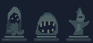

# Octava zona · Galerías del templo

Encargo de diseño e integración para Codex. Base revisada: b56661a, templo de séptima aprobado. Leer AGENTS.md, SEPTIMA-ZONA.md y la implementación de Temple, SaveLoad y EventHandler. El jugador continúa por el templo antes de llegar al jefe. Esta propuesta prepara arte y criterios. La distribución, coordenadas y diálogos se afinan al construir y jugar el mapa.

## Continuidad y transiciones

Usa el mapa interno 9, último libre de maxMap=10. Mantén 50 × 50 como los mapas activos. Conserva los IDs 0–8, en especial templo 4, salas 5 y jefe 6. Conservar el jefe, su arena y su punto de llegada (24,44).

La salida de la séptima (24,5) exige sus cuatro placas como ahora y pasa a la llegada segura de la octava. Propuesta de entrada (24,43), retorno separado en (24,45), descanso (22,41), portón norte (24,6) y transición al jefe (24,5). Al volver a séptima, elige una casilla transitable en el lado ya abierto del portón y fuera de su activador. Comprueba estas coordenadas con la geometría definitiva y evita rebotes de portal. El paso al jefe exige las placas de octava. Una partida que ya está en el jefe conserva su avance.

## Espacio, ritmo y población

Cámaras con ancho útil de 6 a 9 casillas, corredores habituales de 3 o 4 y ensanches antes de combatir. Las guías de rocas y sus accesos quedan en bolsillos tranquilos conectados al circuito. Usa paredes para separar líneas de ataque, en lugar de llenar el piso con estatuas o pilares. Evita que un pasillo de ida y vuelta obligue a pelear cada vez con el mismo grupo.

| Sector | Encuentro inicial | Qué ofrece al jugador |
| --- | --- | --- |
| Vestíbulo tras el descanso | 1 Planta | Liana frontal y dos salidas laterales, sin otro ataque encima |
| Ala oeste escalonada | 2 Plantas separadas por un recodo sólido | Una defiende un acceso lateral. La otra mira a través de su propia sala, fuera del alcance de la primera |
| Ala este de las arcadas | 1 Fishtella | Cámara con refugio lateral para esquivar ambos ejes y volver a golpear el núcleo |
| Cruce de las naves | 1 Planta y 1 Fishtella | La columna separa sus avisos. El jugador puede asomarse desde dos accesos y elegir a cuál enfrentar primero |
| Cámara noroeste | 1 Planta y 1 Fishtella | Desafío mixto con cobertura desplazada. La cámara debe permitir salir de la trayectoria de la liana sin entrar de inmediato en el pulso |
| Tramo noreste | 2 Plantas y 1 Fishtella en tres cámaras pequeñas enlazadas | Dos encuentros separados de liana y un pulso final con esquiva lateral. El trazado impide activar a los tres a la vez |
| Antesala del jefe | Ninguno | Última lectura y espacio de preparación antes de salir |

Punto de partida: siete Plantas y cuatro Fishtellas. Los grupos representan sectores separados, no montones. Límite de dos amenazas activas en una misma posición del recorrido. Usa el alcance y la oclusión para que se cumpla. Si un encuentro se satura, mueve o retira un ejemplar antes de introducir cambios en sus mecánicas. La liana y la descarga nunca alcanzan el refugio, la casilla de lectura de un secreto ni las galerías de empuje. Reutiliza las mecánicas y animaciones aprobadas. Comprueba que los contextos específicos de Temple.MAP se habiliten en 9 donde proceda, manteniendo la configuración y las recompensas de la séptima.

## Puzzle de tres rocas

Conserva el empuje de una casilla y el encaje en la placa. Tres parejas con runas distintas reutilizadas del templo. Dos guías rectas y una con giro para que el jugador tenga que rodear la roca y cambiar de lado. Coordenadas de anclaje propuestas en orden columna, fila, base cero:

| Pareja | Trayecto | Espacio que debe reservarse |
| --- | --- | --- |
| Oeste bajo | (10,39) a (14,39), hacia la derecha | Apoyo inicial (9,39), paso lateral continuo y salida junto al extremo |
| Oeste alto | (8,14) a (8,10), hacia arriba | Apoyo inicial (8,15), paso lateral conectado en ambos extremos |
| Este | (35,32) a (38,32), luego a (38,36) | Apoyo inicial (34,32), acceso lateral a (38,31) para cambiar de lado al llegar al codo y salida junto a la placa |

Identifica cada roca y placa por su pareja, con estado independiente de la séptima. Cada empuje comprueba apoyo, colisión y siguiente casilla del camino. En el codo, solo acepta el nuevo sentido. No admite desvíos, retroceso ni movimiento por empujes de combate. Una roca asentada no vuelve a moverse. El jugador tiene salida desde cualquier paso. El portón abre una vez con las tres parejas correctas y el evento comprueba ese mismo estado. Ningún secreto ofrece una ruta al otro lado del portón. Prueba las seis órdenes de solución y todos los estados alcanzables del giro con jugador y roca reales.

## Estatuas y pasado de D

Coloca las estatuas en tres nichos cortos y separados. Los PNG son transparentes de 32 × 48, dos por tres casillas, con el pedestal en el borde inferior. Escala ×3 sin suavizado. El anclaje es el centro inferior del PNG. Dibújalas detrás de los actores. La colisión proviene del muro del nicho. Deja la casilla de lectura en el suelo de enfrente, con espacio para pasar por delante. No coloques ninguna sobre un carril, un corredor obligatorio o un aviso de ataque.

- Velo, ala oeste. Tres ojos tallados dentro de una figura encapuchada. Una inscripción se ve al acercarse por un corto desvío detrás de la arcada. «Había dos luces cuando bajamos. Al volver, conté la mía». Texto candidato en inglés: «There were two lights when we went down. On the way back, I counted mine.»
- Fauce, ala este. Una boca de piedra en un nicho que se descubre siguiendo muescas discretas en el muro. «Marqué el muro con una D para que supieran por dónde volver». Texto candidato: «I cut a D into the wall so they would know the way back.»
- Centinela, antesala superior. Una figura con aletas abiertas. El fragmento se ve al examinar su cara lateral desde un espacio de acceso opcional. «Todavía dejo la lámpara encendida. No sé a quién espero». Texto candidato: «I still leave the lamp burning. I don't know who I'm waiting for.»

El jugador los lee con la interacción habitual. No son requisitos del puzzle. Las frases sugieren pérdida y culpa. La identidad de la otra luz y la causa quedan abiertas. Mantén los mensajes en el idioma usado por el resto de diálogos, con cortes de línea adecuados. No añadas recompensas, Secret adicionales ni un registro nuevo de coleccionables por estos fragmentos.

## Ambientación y arte

Reutiliza las losas, frisos, pilares, lámparas y tres capas de fondo de la séptima. Conserva su paleta de piedra fría y luces ámbar. Da a la octava identidad con un atrio más estrecho, recodos, vanos entre columnas y el ritmo de las tres estatuas. Ilumina los nichos de lectura, el giro del carril, las placas y los límites de las zonas de combate. Alterna penumbra con puntos legibles. Comprueba la lectura con y sin linterna. Mantén el dibujo del HUD y los avisos separado del oscurecimiento. Usa una máscara de luz y geometría propias del mapa 9 al reutilizar el sistema de la séptima.

Nuevos recursos en assets/: estatua-velo.png, estatua-fauce.png, estatua-centinela.png. Vista conjunta de izquierda a derecha en vista-estatuas.png. La referencia de ImageGen orientó las siluetas. Los PNG de cuadrícula exacta de este paquete se dibujaron aparte para integración.

## Guardado y criterios de aceptación

- Carga el nuevo mapa en TileManager. Versiona el estado de octava de forma independiente. Inicializa sus tres parejas al migrar un guardado anterior. Conserva las cuatro placas, relieves y derrotas de Secret de séptima, los guardados en otras zonas y el progreso de quien ya llegó al jefe.
- Guarda pasos completos y valida IDs, coordenadas de carril y vínculo con placa al cargar. Cargar no modifica el archivo. Usa fixtures separados. Verifica reintento, cambio de área, partida nueva, vuelta a séptima y compatibilidad con partidas del templo ya resuelto.
- Recorre ambas alas y los tres carriles con colisión real. Verifica el giro, seis órdenes, un guardado en el codo y la ausencia de atajos al jefe. Comprueba que cada nicho sea alcanzable, que las tres estatuas no reduzcan el espacio de combate y que los ataques no atraviesen muros ni alcancen zonas de descanso.
- Ejecuta build.ps1 -Test. Entrega capturas de las tres estatuas en contexto, oscuridad con y sin linterna, primer encuentro, encuentro mixto, giro del puzzle y portón antes y después. Informa qué se verificó y qué requiere prueba manual. Conserva el JAR raíz y las partidas personales hasta instrucciones posteriores.
