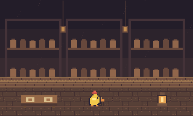
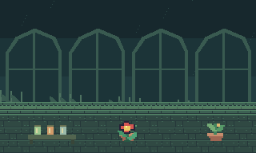
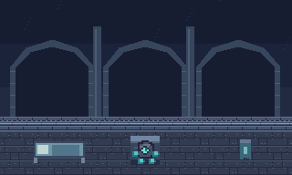

# Tres refugios de D · Chicken, Flower y Spiky

Encargo de arte e integración para Codex. Base consultada: 8654314, octava zona aprobada. Leer AGENTS.md y conservar el avance vigente. Esta entrega fija las parejas NPC/cofre verificadas por conectividad, el diseño de los retos y el contrato de aislamiento. La geometría, el balance y los diálogos se prueban al integrar.

## Referencias exactas del mapa 5

Coordenadas de base cero, columna y fila. Las cajas indican los límites transitables actuales. La frontera visual puede incluir el muro propio contiguo dentro de un rectángulo explícito que excluya otras salas. Mantén los tres recintos en el mapa 5.

| Sala | Puerta exterior | Portal en mapa 5 | Piso actual | NPC actual | Cofre y recompensa |
| --- | --- | --- | --- | --- | --- |
| Chicken | mapa 0 (28,18) | (9,40) | (9,35) a (22,44) | Chicken (20,37) | (20,41), **Linterna** |
| Flower | mapa 1 (9,34) | (40,40) | (27,35) a (40,44) | Flower (28,41) | (28,37), **Poción de vida** |
| Spiky | mapa 1 (39,23) | (40,29) | (27,24) a (40,33) | Spiky (28,26) | (28,30), **Cama portátil** |

Verifica cada entrada con conectividad real, ID de NPC e ID de cofre. Mantén las recompensas y sus IDs aunque muevas el NPC o cofre dentro de su propio recinto. Sitúa al NPC cerca de una llegada segura, con espacio para hablar y regresar. El punto de aparición puede desplazarse del portal en una casilla segura para evitar que el regreso se active al aparecer. Conserva las puertas externas y sus destinos de retorno. Protege los otros cinco recintos y el resto de sus recompensas.

## Chicken · Despensa de las dos luces

Piedra cálida, estantes, cestas, vasijas y mesa con dos raciones. Chicken es un pollito amarillo con cresta roja, pico naranja y ala visible. Sus dos cuadros alternan la posición del ala. Usa la misma dirección visual para sus diálogos y dale un anclaje estable.

- Entrada junto a Chicken y a un primer farol visible. El segundo queda detrás de un mueble o recodo corto, con un recorrido transitable bien iluminado.
- Interactúa para encender ambos, en cualquier orden. El farol cambia de sprite, muestra luz local y conserva su estado al salir. Al encender el segundo, abre físicamente el portón del cofre. Mantén libre el retorno.
- Sin enemigos. La recompensa es la Linterna del cofre original. El reto se puede resolver antes de tenerla y sin consumir nada.
- Diálogo candidato en inglés: «D asked me to leave two lights burning.» / «When D came back, only one went out.» Puede conservar un «Pio» breve en el saludo. Evita usar el chiste en el momento del recuerdo.

## Flower · Vivero de los remedios

Piedra verde apagada, ventanales, macetas de barro y un estante de remedios. Flower sigue siendo una flor roja con centro amarillo, tallo y hojas. Sus dos cuadros mueven una hoja. La silueta floral clara y los colores cálidos del capullo la distinguen de la Planta enemiga.

- Flower permanece en la parte segura junto al portal. Un claro central de unas 6 × 5 casillas deja espacio alrededor de un solo Greeny. Separa el claro del NPC con un recodo o muro corto y limita al Greeny a su cámara. Coloca las macetas al perímetro.
- Derrotar a ese Greeny abre el portón del cofre. El reto no exige parry. Conserva la derrota al volver y cargar, incluido su premio normal, para que salir no permita repetir ese encuentro por EXP.
- Conserva la poción original de +5 de vida. Prueba que la pelea resulte breve y que los otros recintos no suministren enemigos al claro.
- Diálogo candidato: «D asked me for a second dose.» / «It was still sealed when D brought it back.»

## Spiky · Puesto de guardia

Piedra azulada, arcadas, parapetos, estandarte y rincón de descanso. **Spiky es una roca**, con gemas independientes como brazos y pies, y un solo ojo de gema en el centro. Los cuadros alternan la altura de las gemas de los lados y mantienen inmóvil el núcleo. No confundir sus gemas con espinas o aletas de pez.

- Entrada junto a Spiky fuera de líneas de tiro. Dos carriles cortos de Enfadillos estacionarios, uno por tramo, separados por un muro sólido y un recodo. El jugador ve a cada centinela desde cobertura. Asegura espacio para salir lateralmente antes y después de cruzar. Evita solapamiento de disparos, especialmente en la llegada, las esquinas de cobertura y el cofre.
- Se puede completar esquivando o derrotando a los centinelas. Ningún evento exige que estén vivos. Habilita el comportamiento de sentinela solo en esos dos ejemplares, sin cambiar los otros Enfadillos de mapa 5.
- La cama portátil original queda en un nicho protegido. Al llegar al lado seguro, una interacción abre un atajo físico de regreso. Desde la llegada, el atajo cerrado no permite saltar ambos tramos. Usa gate-closed y gate-open para distinguir estados y conserva su estado al cargar.
- Diálogo candidato: «D… D slept here once.» / «The other bed was made. D said it was still taken.»

Los tres recuerdos son independientes. Sugieren que D esperaba a alguien y que algo salió mal, sin confirmar quién era ni cómo ocurrió. Mantén el idioma de los demás diálogos, ajusta los saltos de línea a la caja existente y permite leerlos sin completar el reto. No añadas elementos obligatorios para la progresión principal.

## Integración de sprites, tiles y cámara

- Inventario en [manifest.json](manifest.json). PNG transparentes de NPC 16 × 16, dos cuadros con mismo origen. Props de 16 × 16 o 32 × 16, anclados en la base. Escala ×3, vecino más cercano. Cambia las rutas de sprite de los NPC para esta entrega. Conserva su identidad, interacción e IDs de guardado.
- Los pisos y portones abiertos son transitables. Muros, frisos, parapetos y portones cerrados son sólidos. Los props son decorativos o se sitúan sobre una colisión de mobiliario explícita, según el mapa definitivo. Usa el farol apagado/encendido como estado visual. Los 3 fondos son PNG opacos de 320 × 192. Las muestras en preview son composiciones de referencia, no recursos del motor.
- Asigna un ID estable a cada recinto, rectángulo de dibujo, máscara o lista de tiles propios y rectángulo de cámara. Usa su fondo antes de dibujar terreno y actores. Reserva zonas de borde o vanos para verlo. No rellenes todo con terreno opaco. Si el recinto es más pequeño que la vista, céntralo y completa los márgenes con su propio fondo. Mantén controles, HUD y diálogos en la pantalla habitual.
- Resuelve el recinto activo al entrar o cargar desde un punto válido. Cambia posición, recinto y cámara juntos durante el fundido. No determines el recinto por la proximidad del NPC. Limita el dibujo de terreno y entidades a lo que pertenece al recinto activo, incluidos cofres, luces, partículas y proyectiles. Un simple clip de pantalla o una cámara centrada sin filtro de pertenencia no basta.
- Aplica también los límites al minimapa y mapa completo, incluyendo indicadores. Solo los enemigos, proyectiles e interacciones del recinto visitado se actualizan. Limpia efectos transitorios al salir. Comprueba las otras cinco salas del mapa 5 con sus límites existentes para evitar que una sala rediseñada se vea desde ellas. No cambies sus retos, arte ni premios.
- Arte visual de fondo y NPC realizado en cuadrícula nativa. La referencia conceptual de ImageGen se usó para explorar las tres ambientaciones. No forma parte del conjunto que carga el motor.

## Persistencia y comprobaciones

- Usa estados por recinto. Chicken conserva los dos faroles, Flower la derrota y Spiky el atajo. Mantén separado el progreso de la apertura del cofre. Con inventario lleno, el premio queda en el cofre y el regreso sigue libre.
- Preserva ID y estado de cofre abierto de partidas anteriores. Cuando uno ya esté abierto, adapta su reto al estado terminado. Si está cerrado, inicializa el reto y conserva la recompensa. Si una posición antigua quedó en sólido, recoloca al jugador en la entrada segura de esa misma sala. No reescribas la partida al cargar.
- Prueba las tres parejas desde sus puertas originales, salida y vuelta, cámara en las cuatro esquinas, minimapa y guardado a mitad de cada reto. Comprueba que no se actualice ni se dibuje ningún actor o proyectil de otra sala y que las otras cinco siguen accesibles.
- Valida los dos órdenes de los faroles, la derrota única del Greeny, ambos cruces de Spiky sin matar centinelas, la variante derrotándolos y el atajo. Comprueba cofres con inventario lleno y guardados con premios ya cobrados.
- Ejecuta build.ps1 -Test y entrega capturas del NPC, una esquina y la recompensa de cada sala. Usa guardados de prueba aislados. Conserva el JAR raíz y las partidas personales hasta instrucciones posteriores.
