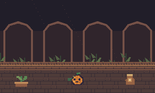
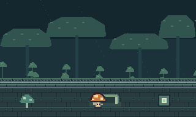
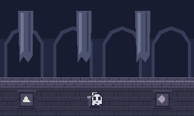

# Tres refugios de D · Pump, Hongui y Ghost

Encargo de arte e integración para Codex. Base revisada: 1a7129d, primeras tres salas aprobadas. Lee AGENTS.md, SALAS-EXTRAS-1-3.md y ExtraRooms antes de modificar el mapa. Las premisas y diseños siguientes son propuestas concretas de esta entrega. Ajusta geometría y tiempos al probar sin cambiar las recompensas ni imponer equipo que todavía no puede haberse obtenido.

## Parejas verificadas por conectividad

Coordenadas de base cero, columna y fila. Las puertas están en la tercera zona, mapa interno 2. Los recintos están en el mapa 5.

| Sala | Puerta en mapa 2 | Portal en mapa 5 | Piso actual | NPC actual | Cofre y recompensa |
| --- | --- | --- | --- | --- | --- |
| Pump | (39,13) | (9,29) | (9,24) a (22,33) | (20,26) | (20,30), **poción de vida +5** |
| Hongui | (9,17) | (9,19) | (9,14) a (22,22) | (20,15) | (20,20), **Super Shield** (defensa base 3) |
| Ghost | (19,16) | (40,19) | (27,14) a (40,22) | (29,15) | (29,21), **Rocky** |

Conserva slots, IDs y premios. Reubica a cada NPC junto a su llegada, en un espacio seguro, y mantén el cofre dentro de su propio recinto. Propuesta de llegada segura Pump (10,29), Hongui (10,19), Ghost (39,19). Verifica la geometría y no superpongas el spawn con el evento de regreso o un objeto. No cambies las puertas externas ni sus retornos.

## Pump · Huerto de la última cosecha

Calabaza anaranjada, ojos tallados y tallo verde curvado. Los dos cuadros cambian discretamente la boca. Piso de piedra tibia, arriates, raíces y tinajas. La recompensa modesta pide una visita breve, sin desgaste por combate.

Dos ataduras de liana secas bloquean sendas cortas que rodean un arriate. Se pueden cortar en cualquier orden con un golpe cuerpo a cuerpo de cualquier arma actual. Se reconocen por la cinta anudada, lejos del aspecto de piedra o metal. Usa binding-intact y binding-cut como formas anterior/posterior, con restos sin colisión. Al cortar ambas se abre físicamente el acceso al cofre. No dan EXP ni drops.

Sin enemigos. Conserva disponible el retorno. Un pequeño atajo de circulación puede quedar abierto al cortar una atadura, pero el cofre requiere ambas. Como anclajes de diseño para los obstáculos, considera (14,27) y (17,30); ajusta al mapa para que los ramales y el acceso del NPC queden libres. Ninguna atadura requiere Rocky, porque este objeto se obtiene en otra sala de la misma zona.

Diálogo propuesto: «D always asked me to save some seeds.» / «The last time, D brought back a basket full of earth.» / «Nothing had been planted.» La cesta vacía y las tinajas apoyan la pérdida sugerida sin declarar qué ocurrió.

## Hongui · El abrigo de esporas

Seta de sombrero anaranjado, manchas claras, tallo crema y pequeños brazos. Los dos cuadros alternan los brazos. Gruta azul verdosa con hongos luminosos y un dosel de piedra que protege al NPC.

Un solo Picarón patrulla una cámara despejada de unas 6 × 5 casillas, separado del NPC y la llegada por un recodo. Usa el ataque original con un territorio corto, sin persecución fuera del recinto. El objetivo de la prueba es resistir **dos ataques distintos con guardia frontal o parry**. El jugador también puede derrotarlo para completar el reto. Así la sala sigue siendo resoluble si se mata al enemigo antes de bloquear.

El indicador guard-mark-0/1 comunica el avance en un lugar junto al cofre. Dibuja dos marcas, una por bloqueo válido, y muéstralas completadas si se derrota al enemigo. Incrementa por un ataque real resuelto contra guardia, una sola vez por ID/ciclo de ataque. No cuentes acercarse, mantener Space sin impacto, recibir daño de espaldas, invulnerabilidad o los cuadros de una misma animación. El escudo inicial basta. No cambies las reglas globales de Picarón ni obligues a parry perfecto.

Dos bloqueos válidos o la derrota abren el portón del Super Shield. El cofre y su lectura están fuera del alcance del Picarón, con acceso desde una salida segura de la cámara. La victoria por guardia no da EXP extra ni mata automáticamente al enemigo. La derrota posterior conserva su recompensa normal una sola vez. Mantén el progreso parcial, el reto terminado y la derrota separados. No uses un enemigo ya derrotado como requisito al volver.

Diálogo propuesto: «I hid under my cap when the noise started.» / «D stood in front of me.» / «I never saw what was behind D.» El cobijo es parte de su carácter y conecta con el escudo que entrega.

## Ghost · Las huellas que quedan

Fantasma blanco, dos ojos oscuros y boca pequeña asustada. Los dos cuadros cambian la boca, con encuadre estable. Archivo sumergido azul violeta con telas gastadas, arcos y piedras de memoria.

Sin enemigos. Desde el espacio seguro, Enter activa un pedestal que presenta una secuencia de tres símbolos, uno a uno, con pausas legibles. Usa los tiles memory-0 (triángulo), memory-1 (cuadrado) y memory-2 (rombo). Orden inicial propuesto 0,2,1. Cada activación del pedestal permite volver a observar la misma secuencia. No la aleatorices al entrar o cargar.

El jugador pisa los tres símbolos en ese orden. Cuenta únicamente la entrada completa en la casilla del símbolo, no cada tick que permanece sobre ella. Las tres se alcanzan sin pisar otra obligatoriamente y quedan dentro de la luz ambiental. Cada acierto conserva el prefijo y enciende la piedra. Un error apaga el prefijo y permite repetir desde el primero, sin daño ni reinicio del recinto. Durante una demostración, congela solo el registro de respuestas y deja claro que el jugador está observando. Un texto breve explica «Watch the marks. Then follow them.» sin revelar la solución. Ofrece repetirla al volver al pedestal.

Al completar se abre el portón del cofre Rocky. El jugador puede salir en todo momento. No bloquees el pedestal, el camino ni los símbolos con piedras destructibles, y no exijas linterna, Super Shield o Rocky. La recompensa es necesaria para avanzar en la tercera zona. Al salir de la sala, se mantiene el aprendizaje exterior de las primeras piedras.

Diálogo propuesto: «D came back counting footsteps.» / «There should have been another set.» / «Please… don't ask me whose.» Conserva su temor y evita confirmar que el fantasma sea una persona concreta del pasado de D.

## Arte e integración

- Inventario en [manifest.json](manifest.json). Dos PNG de 16 × 16 por NPC con idéntico anclaje. Son frames de idle y diálogo. Usa el mismo encuadre para los cuatro sentidos, como los NPC actuales. Props de 16 × 16, excepto shelter de 32 × 16. Escala ×3 con vecino más cercano.
- Piso y símbolos de memoria transitables. Muros, frisos y portón cerrado sólidos. Portón abierto transitable. Las ataduras tienen colisión solo mientras están intactas. Los hongos y jarras son decoración al borde del camino, con una colisión de mobiliario solo si el trazado la necesita y la representa. No conviertas las piedras de memoria en interruptores físicos que puedan desplazarse.
- Cada fondo es opaco de 320 × 192 y pertenece a su recinto. Reutiliza ExtraRooms para cámara, bordes y márgenes. Deja huecos o bordes donde se vea el fondo sin cubrirlo por completo con terreno opaco. Las imágenes de preview muestran el arte compuesto y no se cargan como mapa o fondo.
- Extiende el patrón de art por sala de Room.PUMP, HONGUI y GHOST. Mantén la cámara, los filtros de pertenencia y las máscaras del sistema actual. No se ve ni actualiza contenido de otro recinto en pantalla, mapa completo, minimapa, luces, partículas o proyectiles.
- Haz la gruta y el archivo legibles sin linterna, con fuentes pequeñas de hongos/pedestal si hace falta. Ilumina el indicador de guardia y la preparación de Picarón, conserva espacio lateral. Los NPC y cofres quedan fuera de ataques. Nunca cierres la puerta de retorno al iniciar el reto.

## Progreso y compatibilidad

ExtraRooms ya usa REVISION=1 y ALL_FLAGS=63 para las primeras salas. No repurposes esos bits. Extiende el formato con estados nuevos o campos separados, valida sus rangos y migra guardados anteriores deliberadamente. Conserva faroles, derrota del Greeny, centinelas y atajo de Spiky. Preserva NPC, cofres y desafíos de Chicken, Flower, Spiky, Ic y Handy. El generador de terreno cambia solo estos tres recintos y sus muros contiguos. ExtraRooms ya enumera los ocho rectángulos y selecciona por posición.

Pump conserva dos ataduras cortadas. Hongui conserva bloqueos 0..2, reto completado y derrota del Picarón. Ghost conserva prefijo 0..3 y reto completo, y cancela una demostración transitoria al cargar. Premios separados de progreso. Si un cofre ya estaba abierto en un guardado anterior, marca completado su reto y conserva el inventario. Si estaba cerrado, inicializa el reto y permite volver a obtenerlo por la vía prevista. Con inventario lleno no consumas premio ni encierres al jugador. Recoloca solo posiciones incompatibles en la llegada segura de esa misma sala. Cargar no reescribe el archivo.

## Validación de Codex

1. Recorrer desde las tres puertas externas hasta los NPC y cofres, y de vuelta. Comprobar parejas exactas, inventario lleno y cargas con cofre abierto/cerrado.
2. Pump con cada orden de corte y con armas admitidas, sin depender de Rocky. Atadura cortada sin colisión y reto terminado sin drops repetibles.
3. Hongui por dos bloqueos distintos con escudo inicial, por parry y por muerte del Picarón antes/después de un bloqueo. No contar los cuadros de un mismo golpe. Probar guardar tras un bloqueo, tras completar sin matar y tras matar. Conservar EXP única y no repoblar la baja.
4. Ghost con demostración repetible, tres aciertos, error, espera en una piedra, salida/regreso a la misma piedra y carga con prefijo parcial. No permite completar manteniéndose inmóvil ni pisando en orden incorrecto. La secuencia siempre es visible sin equipo ajeno.
5. Las ocho salas conservan aislamiento. Capturas de las cuatro esquinas y prueba de actores, luces y proyectiles ajenos, mapa completo y minimapa. Revisar las primeras tres salas y sus estados para detectar regresiones.
6. Ejecutar build.ps1 -Test, ampliar las suites de ExtraRooms y guardados para estos casos, revisar capturas de NPC, reto y cofre. No atribuir a esta entrega pruebas de juego aún no realizadas. El usuario revisa el resultado antes de reemplazar el JAR raíz o publicar la implementación.
