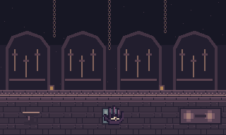
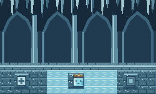

# Dos refugios finales de D · Handy e Ic

Encargo de arte e integración. Base revisada: a404661, primeras seis salas aprobadas. Leer AGENTS.md, SALAS-EXTRAS-1-3.md, SALAS-EXTRAS-4-6.md, QUINTA-ZONA.md y ExtraRooms. Se preparan recursos y condiciones de implementación. El trazado, la iluminación y el balance se verifican al integrar.

## Parejas y accesos confirmados

Ambas salas están en el mapa 5 y se visitan desde la quinta zona, mapa interno 3. Coordenadas columna/fila y base cero.

| NPC | Puerta exterior | Portal de sala | Piso actual | NPC actual | Cofre y premio |
| --- | --- | --- | --- | --- | --- |
| Handy | (9,5) en mapa 3 | (40,9) en mapa 5 | (27,5) a (40,12) | (28,6) | Slot 8, (28,11), **Iron** |
| Ic | (14,40) en mapa 3 | (9,9) en mapa 5 | (9,5) a (22,12) | (20,7) | Slot 7, (20,10), **segunda arma** |

Conservar identidad de NPC, slots y tipos de recompensa. Handy entrega la herramienta tipo 10 que rompe metal. Ic entrega OBJ_Second_Weapon, arma tipo 3 con ataque base 3 y duraciones 3/15. Ningún reto puede requerir su propia recompensa. La puerta externa sigue usando su tile de puerta y la quinta conserva su barrera obligatoria de Iron. Una llegada segura propuesta es Handy (39,9) e Ic (10,9), pendiente de validar contra el terreno definitivo. Coloca al NPC junto a esa llegada, en un espacio libre de ataques.

## Handy · Taller de lo que todavía puede repararse

Mano violeta oscura con cinco dedos y un único ojo claro en la palma. Dos cuadros de animación, uno con ojo abierto y otro entornado. Fondo de arcadas, cadenas y herramientas de piedra con luces cálidas. Anvil, tool-rack, chain, mechanism-0/1 y sconce completan el entorno. El mobiliario se coloca junto al muro.

Dos cerrojos de piedra se rompen con Rocky y abren un mecanismo que protege Iron. Usa stone-latch-intact y stone-latch-broken. Como punto de partida, conserva la resistencia de las piedras especiales existentes, dos golpes válidos. Cada cerrojo tiene un bit propio y al romperse deja restos sin colisión. Corta físicamente el acceso al cofre con gate-closed, abre cuando ambos estén rotos y muestra mechanism-1. Muestra mechanism-0 sin cerrojos rotos, mechanism-left al romper solo el izquierdo, mechanism-right al romper solo el derecho y mechanism-1 con ambos. Los dos rotores permiten reconocer cada avance. No produce EXP ni drops.

El primer cerrojo se prueba desde una zona iluminada sin ataques. El segundo queda tras un corto tramo vigilado por un Enfadillo estacionario, con cobertura permanente y salida lateral. Reutiliza la variante de burbuja legible de Spiky si el espacio lo requiere. Solo ese ejemplar cambia de comportamiento. La conversación, los cerrojos y el cofre quedan fuera de su línea de tiro. Se puede resolver esquivándolo o derrotándolo. El reto no exige parry.

Al acercarse con otra arma, muestra un recordatorio contextual de equipar Rocky. Al abrir, retíralo. El regreso permanece accesible aunque falte equipo o espacio de inventario. Comprueba esta condición antes de cerrar un acceso para una partida anterior. Para una partida anterior sin Rocky que ya está en quinta o más adelante, inicializa los dos cerrojos rotos y mantén el cofre de Iron en el estado que tenía. Se conserva así el avance recuperable. La excepción se ejecuta durante la migración, se guarda y no vuelve a evaluarse como regla de salida.

La venta actual impide vender equipo puesto, pero permite vender otros objetos. El único NPC que abre el comercio es TV, colocado en mapa 6, posterior a Handy y a la barrera de Iron. El recorrido normal nuevo ya exige Rocky antes de quinta. Conserva esas reglas y prueba esta suposición con las transiciones actuales. La migración anterior cubre el guardado histórico sin Rocky y no entrega objetos ni crea una fuente de monedas. Si detectas otra vía real de perder Rocky antes de Handy, resuélvela sin cerrar al jugador en la sala y documenta el caso.

Diálogo candidato: «D asked for a tool to open what had been sealed.» / «When D came back, there was nothing left to open.» Después del reto: «Keep your hands steady, D.» El pasado sugiere una reparación demasiado tardía.

## Ic · Cámara de las huellas congeladas

Cubo de hielo celeste, dos ojos, boca y pequeña corona dorada. Dos cuadros de animación con movimiento mínimo de la boca. Fondo de columnas, arcos escarchados y carámbanos. Mantén una silueta cúbica que no parezca una gota. Usa frost-wall y icicles sobre muros, dejando transitable el recorrido.

El reto consiste en deslizarse entre apoyos para activar dos marcas distintas, mark-0 y mark-1. No tiene enemigos ni daño por terreno. Las dos marcas se pueden visitar en cualquier orden y conservan su estado al salir. Ambas abren el portón del arma. El jugador puede recorrer toda la sala con su equipo inicial.

- ice-0/1 representa hielo pulido, con líneas continuas de brillo. rough-stop representa piedra rugosa, con grano y borde. Las marcas son apoyos rugosos, no hielo. El piso común junto a Ic, el retorno, el cofre y los accesos también permite detenerse normalmente.
- Primer tramo corto y recto con un apoyo visible enseña el movimiento. Después, dos ramales con giros y superficies de parada llevan a cada marca. Conecta los apoyos al circuito de regreso. Nunca encierres una marca detrás de un trayecto que exija haberla activado.
- Al entrar completamente en una celda de hielo desde una dirección cardinal, mantiene esa dirección hasta un apoyo o un obstáculo sólido. Comienza con una velocidad equivalente al movimiento normal. No aceleres al acumular teclas. No permite girar durante un tramo. En el apoyo, termina el deslizamiento y espera una nueva orden cardinal para el siguiente tramo.
- Si llega a un muro, se detiene en la última posición válida, sin penetración ni daño. Puede iniciar otra dirección desde esa posición. Comprueba que estos puntos de parada también permiten volver al retorno. No se necesitan saltos, diagonales ni precisión de reflejos.
- Al llegar a una marca, centra la parada de forma coherente con la cuadrícula, activa su bit una sola vez y cambia al sprite encendido. Es la llegada física a la superficie la que cuenta. No avances el estado mientras permanece quieto.
- Pausa, diálogo, inventario y opciones congelan el movimiento y sus temporizadores. No deslices por el área del NPC o por un portal. Al cambiar de mapa, cargar o morir, cancela la velocidad retenida y la entrada pendiente. Guarda una posición válida y dirección, nunca una referencia viva al controlador.
- Valida la red de apoyos con todas las órdenes cardinales. Desde toda parada alcanzable se puede llegar al retorno y, con ambas marcas, al cofre. Si el trazado no cumple, modifica el terreno antes de inventar un botón de reinicio.

Diálogo candidato: «D asked if cold could keep something from fading.» / «I could keep a footprint.» / «I couldn't promise someone would follow it back.» Después del reto: «Your tracks are still here.» La conservación y la ausencia guían la escena.

## Integración visual y de salas

Los PNG se enumeran en [manifest.json](manifest.json). NPC y tiles nativos de 16 × 16, mecanismo de 32 × 16. Escala ×3 y vecino más cercano. Los dos cuadros de NPC mantienen origen y base idénticos y se usan para idle y diálogo en cualquier sentido, como los NPC actuales. Los cuadros no representan direcciones nuevas.

Fondos opacos de 320 × 192, exclusivos de cada sala. Las vistas preview son composiciones de revisión y no se usan como recursos de juego. Muros y portón cerrado son sólidos. Piso rugoso, hielo y marcas son transitables. El estado del cerrojo define su colisión. Cadenas, herramientas, yunque y carámbanos se colocan junto al muro o como decoraciones sin bloquear las rutas calculadas. La fuente de cada sconce nace en la cara visible de piso junto al muro y respeta la oclusión.

ExtraRooms ya centra y aísla cada recinto y mantiene estados independientes. Activa arte para Room.HANDY e IC dentro de los rectángulos existentes, extendiendo los tiles por sala. Conserva los otros seis recintos, sus imágenes de cámara, retos, proyectiles y progresos. La simulación, los ataques, las luces y los mapas se filtran por sala. El deslizamiento solo se activa sobre los tiles de hielo de Ic en su recinto. No cambia el movimiento de otras zonas.

## Persistencia y aceptación

ExtraRooms usa revisión 2 para los primeros seis retos. Añade una revisión deliberada y campos nuevos para los dos bits de cerrojo, dos marcas y la derrota del centinela. No reutilices los bits o campos de los retos anteriores. Guardar/cargar preserva el progreso y la identidad de los cofres. Un cofre ya abierto en una partida antigua completa su reto sin otorgar otra recompensa. Posiciones incompatibles se recolocan en una entrada segura de esa misma sala. Cargar no reescribe el archivo original.

Pruebas requeridas de Codex:
1. Puertas y recompensas correctas desde la quinta. Completar Handy sin Iron ni arma mejorada y completar Ic sin su arma. Probar los dos órdenes de cada reto.
2. Cerrojadura con golpes reales de Rocky, armas incorrectas sin efecto, restos sin colisión y acceso al cofre tras dos cerrojos. Probar esquiva y derrota del único centinela, entrada y conversación sin daño y ausencia de EXP repetible.
3. Probar cada tramo de hielo, teclas repetidas y opuestas, pérdida de foco, diagonales, paredes y llegada parcial. Pausar y abrir inventario mientras desliza y comprobar que se reanuda coherentemente. No se activa una marca hasta llegar.
4. Red completa de paradas sin atascos, cofre y retorno alcanzables con colisiones reales. Guardado en apoyo y en desplazamiento con resolución segura, ambas marcas y premio cobrado.
5. Guardados anteriores con cofre abierto/cerrado, ausencia de Rocky y progreso de las seis salas aprobadas. Inventario lleno conserva premio y salida libre. La quinta sigue exigiendo Iron para avanzar al mapa siguiente.
6. Cámara en las cuatro esquinas de ambas salas, transición de entrada/salida, mapa y minimapa, filtros de actores/partículas/proyectiles. Verificar las otras seis salas por regresión.
7. Ejecutar build.ps1 -Test y entregar capturas de NPC, reto, cofre y esquina por sala, y hielo/apoyo distinguibles con iluminación real. Usar fixtures aislados, conservar partidas personales y dejar el JAR raíz y la publicación de la implementación para revisión del usuario.

Esta entrega prepara arte y condiciones de integración. La implementación jugable y su balance quedan para Codex.
