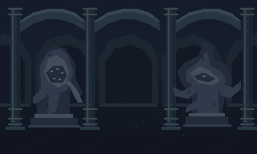
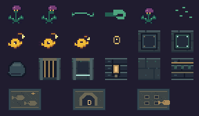

# Séptima zona · Templo sumergido

Paquete de arte y encargo para Codex. Las mecánicas y siluetas de Planta y Secret fueron aprobadas por el usuario. El trazado, la iluminación, el número de encuentros y los textos de murales son propuestas de integración de esta entrega.

La muestra reúne Planta en la primera fila, Secret y placas en la segunda, roca, portón, lámpara y losas en la tercera, y los tres murales abajo. El inventario completo está en [manifest.json](manifest.json).

## Recorrido e identidad

La antigua sexta conserva su ID interno **4**. Usa 50 × 50 casillas como el resto del motor. Mantén entrada desde la nueva sexta, mapa 8, en (24,42), retorno en (24,44) y salida al jefe, mapa 6, en (24,5). Verifica los destinos y puntos de aparición de ambas rutas contra la base actual. Conserva el acceso a descansos, los diálogos vigentes y las funciones de las salas existentes.

- Desde el embarcadero sur, una nave iluminada presenta las cuatro runas de las placas. Un ramal corto muestra primero a Planta sola, con espacio para esquivar lateralmente.
- Cuatro galerías conectadas por un circuito rodean el atrio. Puedes resolverlas en cualquier orden. Alterna una antesala de Planta, una cámara abierta de Fishtella y descansos. Distribución inicial sugerida: seis Plantas y tres Fishtellas entre cámaras separadas, máximo dos amenazas simultáneas en encuentros mixtos. El empuje se hace en galerías sin enemigos ni ataques que las atraviesen.
- Un muro continuo cerca del norte delimita la cámara de salida. El único hueco es el acceso del portón, que lleva a la casilla de transición. Las placas encendidas y cuatro runas visibles junto al portón indican el progreso.
- Relieve del pez detrás de una columna en el ala oeste. Relieve de la lámpara al fondo de un corredor que parece terminar en el ala este. Cada uno se examina mirando al relieve y abre un nicho independiente con un Secret. Usa una pequeña pista en un mural o una marca ambiental. Sin mapa de tesoro visible, pasos a través de sólidos ni vínculos con las cuatro placas. Cada nicho tiene un circuito corto para interceptar al pez y una salida clara.
- Traslada los dos Secret existentes del mapa 5 a estos nichos. Conserva sus dos identidades de recompensa para que no se duplique la EXP disponible. Mantén el resto de los encuentros del mapa 5. En el templo, concentra la población en Planta, Fishtella y estos dos Secret.

## Cuatro rocas, cuatro placas

Cada roca tiene su propio carril recto, delimitado visualmente con los tiles de guía. Los pares llevan runas distinguibles por forma. Estas coordenadas son una propuesta de anclaje para adaptar al mapa definitivo, en orden columna, fila y base cero.

| Galería | Inicio | Placa | Casilla de empuje inicial | Dirección |
| --- | --- | --- | --- | --- |
| Noroeste | (11,15) | (11,10) | (11,16) | Arriba |
| Noreste | (35,12) | (40,12) | (34,12) | Derecha |
| Suroeste | (13,31) | (8,31) | (14,31) | Izquierda |
| Sureste | (36,30) | (36,35) | (36,29) | Abajo |

En cada galería, el jugador puede llegar a la casilla tras la roca desde el circuito, cruzar por un corredor lateral y salir desde cualquier etapa, incluida la placa activada. Reserva ese pasillo por toda la longitud del carril y conéctalo a sus extremos. Las rocas son sólidas y los carriles son transitables a pie. Limita el movimiento de cada roca a un paso cardinal hacia su placa por empuje válido. El empuje desde un lateral o desde el frente no la mueve. Comprueba destino y espacio real con la colisión del jugador y la roca. Bloquea nuevos empujes mientras el anterior está en curso y fija el destino exacto de casilla al terminar. Al llegar a su placa queda encajada.

Comprueba las cuatro parejas por ID y su ocupación exacta. Sustituye el criterio genérico de contar las rocas enlazadas presentes en el mapa, que podría abrir el portón con un conjunto incompleto. La cuarta placa cambia el portón a abierto una sola vez, activa la transición y enciende las cuatro runas. La colisión y el evento deben coincidir con el estado visual. No borres puertas ajenas. Un empuje incompleto no se guarda como posición fuera de cuadrícula. Conserva el último paso completo o termina de manera atómica antes de guardar.

## Planta, ataque de liana

Se enraíza en su sector. Usa las dos poses idle para respirar. Al detectar al jugador dentro de aproximadamente dos casillas y con línea libre, orienta el capullo en una dirección cardinal. Mantén la pose aim de esa dirección durante el aviso y fija la línea desde entonces. Como primera prueba, usa 36 ticks de aviso y un tirón máximo de 24 ticks a 60 Hz.

Extiende la liana desde la base, dibujada detrás del capullo con el segmento mid repetido y tip al extremo. Recorta los segmentos al largo visible, también cuando se repliega. Las uniones están alineadas en el centro de cada celda. El alcance de la caja de ataque debe seguir la punta y el tramo activo, y terminar en el primer obstáculo sólido. La liana puede enganchar una vez por ataque. El jugador conserva ataques y puede cortar el tramo cercano con su golpe normal. El parry frontal evita el enganche y fuerza el repliegue. Si el tirón llega al capullo, aplica un golpe y libera al jugador. Si el trayecto se bloquea, se corta, se acaba el tiempo o muere la Planta, libera al jugador y repliega.

Mantén como máximo una liana enganchada al jugador. El tirón usa colisión real en cada paso, sin atravesar muros, empujar rocas ni disparar portales. Usa retract durante el repliegue y vine-cut como señal breve al cortarla. Da una ventana de contraataque antes de preparar otra liana. Evita que el daño genérico por contacto se sume al golpe del capullo. Prueba que el golpe que corta también se pueda ejecutar en una situación real de tirón. Mantén sprite y caja de la Planta en el mismo anclaje.

## Secret, huida y premio

Usa oculto, huida y agotado en cuatro direcciones, con dos cuadros cada uno. Cerca del escondite, deja ver primero el brillo de la antena. Al detectar al jugador se aleja por un camino transitable de su nicho. Durante la huida deja hasta dos burbujas señuelo activas, con dos cuadros de decoy y deriva lateral corta. No son objetos de inventario, no causan daño y no dan recompensas. Se eliminan al expirar y al cambiar de mapa.

Tras unos 180 ticks de huida a 60 Hz, detén el impulso y muestra agotado. La antena baja y el ojo se cierra. Como primera prueba, usa 90 ticks de descanso antes de que pueda huir de nuevo. Mantén el cansancio acumulado aunque cambie de dirección. La huida no atraviesa terreno, placas, rocas ni salidas. Acorrala al pez con espacio suficiente para golpearlo. Reutiliza el canal de daño y recompensa del juego, sin daño por contacto del pez. Cada Secret da sus 100 de EXP una vez por partida. Registra la derrota y la concesión juntos para impedir duplicados por múltiples golpes, recarga de área o reaparición. El pez que escapa se puede volver a intentar. Una partida nueva restablece los dos bonos.

## Arte e iluminación

Todos los PNG de tiles, enemigos y rompecabezas son de 16 × 16 con escala ×3 y vecino más cercano. Los murales son 48 × 32, equivalentes a 3 × 2 casillas. Dibuja el arte encima de un muro sólido y deja el punto de lectura en el piso adyacente. Los relieves son los propios indicadores de interacción. Mantén el muro sólido hasta resolver su acceso.

- Piso transitable: floor-0..2, moss, rail-horizontal, rail-vertical y rest. Muro sólido: wall, wall-frieze, pillar, lamp-wall y relieves cerrados. Activa el umbral con gate-open, tras comprobar las cuatro placas. Coloca return-arch en el acceso de regreso. Apila rune-1..4 sobre sus rocas y placas para emparejarlas.
- Fondo de 320 × 192 por capa: deep-naves opaca al fondo, arcades transparente en el plano medio y statues transparente delante de las arcadas. Aplica un parallax leve y encuadra para evitar saltos o bordes de imagen. Muestra el fondo en huecos y vanos de la nave. Las estatuas son siluetas de piedra tallada, sin interacción.
- Oscuridad constante más fuerte que la quinta. En puntos de decisión, coloca lamp-wall y su fuente sobre la cara transitable del muro para que la máscara no la bloquee. Ilumina el empuje, los murales y el aviso de la liana. Mantén tramos con penumbra y utilidad para la linterna. Conserva legibles los pulsos de Fishtella y los dos tipos de runas. Ajusta con capturas con y sin linterna.
- Murales en orden: procession (una comitiva de peces antiguos), d-threshold (una D grabada sobre el umbral) y four-weights (cuatro pesos al pie de un pez). Textos candidatos: «Los peces bajaron en fila. Uno llevaba una luz pequeña», «La D fue grabada encima de marcas mucho más antiguas» y «Cuatro pesos guardaban el paso. D. Conté cuatro y dejé una luz encendida por si volvía». Sugieren el pasado de D y dejan abierto quién hizo los grabados.
- Fishtella reutiliza sus sprites aprobados y el ciclo de blindaje, aviso, pulso y núcleo abierto de la sexta. Extiende su disponibilidad al mapa 4 usando la implementación existente y conserva el resto de sus encuentros.

## Guardado y validación

Revisa AGENTS.md y el estado de sexta antes de implementar. Conserva IDs de mapas y tipos. Versiona el nuevo trazado del templo. Usa IDs estables para rocas, placas, relieves y Secret. Para guardados anteriores, conserva la posición válida y recoloca solo si hace falta. Reconoce el portón ya abierto y las placas ya resueltas y traduce esos estados al nuevo carril. Restaura el resto a posiciones válidas documentadas. Mantén los jugadores ya avanzados en el jefe y cualquier evidencia confiable de derrota anterior de Secret. Si el guardado antiguo no conserva evidencia de la EXP ya cobrada, documenta el límite. Guarda la derrota con la nueva versión desde entonces. Cargar no reescribe el archivo. Los estados transitorios de combate se limpian al cambiar de mapa, morir, recargar el mapa o cargar partida. La pausa normal congela los temporizadores.

Prueba el recorrido con colisiones reales, los empujes desde todos los lados y las 24 órdenes de resolución, incluyendo guardados parciales y las cuatro activas. Verifica que no haya desvíos al jefe con menos de cuatro, y que el jugador pueda salir de cada carril sin reiniciar. Prueba enganche, corte, parry, pared, interrupción y dos Plantas, incluidos combates mixtos. Prueba detección, fatiga, señuelos y EXP de los dos Secret al volver, guardar y cargar. Ejecuta `build.ps1 -Test` y entrega capturas del templo con y sin linterna, un mural de D, la liana en tres fases, Secret agotado, una placa activa y la salida antes y después. No reemplaces el JAR raíz hasta recibir esa instrucción.

Esta entrega prepara el arte y las condiciones de integración. La programación, el trazado definitivo y el balance se verifican en Codex.
